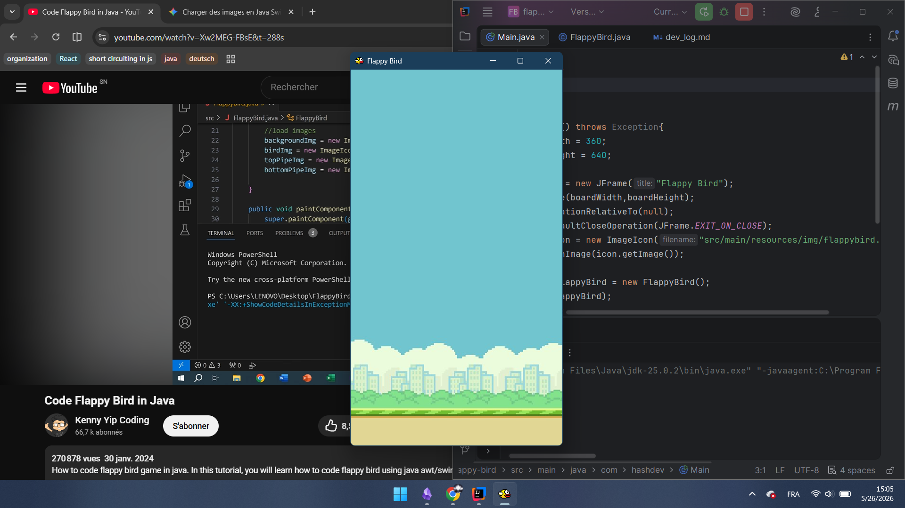
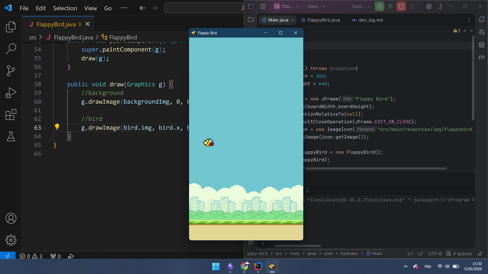
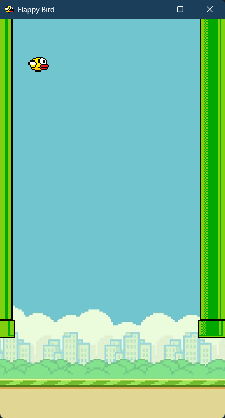
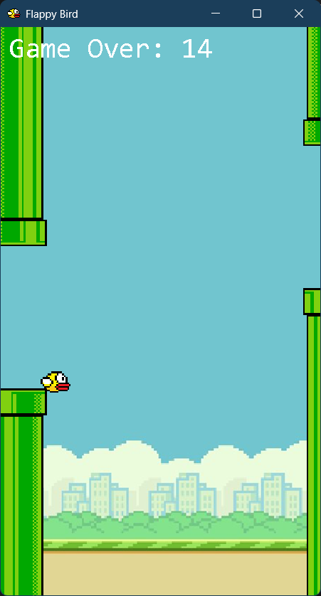

# Some encountered prob while coding
### 1. __import d'img qui ne marche pas dans maven...__  
Pour importer une img dans un projet mvn, don't start with the root, it won't work. La racine c'est `src/main/resources` donc just gives what follows next starting with `/`
### 2. keyListener implementation but not in the good one
so...I put it in typed instead of pressed so the bird wasn't going  up
# Some steps hehe O(∩_∩)O

### -  Flappy window

### - Recap 1
Create a window 360x640 pixels
Import imgs and create panel and add the bg 
Also create some draw functions (kinda get the concept of it but didn't know about it) // It's to draw the elements 
create bird and its attribute and add it 
draw him (add function in the draw function)

### Yo ! flappy is here !

Now I gotta make the game loop and the movement of the bird

#### Game loop
Ok from what I understand for the __Game loop__, I need a timer to regulate the fluidity of the game (speed of frame per sec) set to 60 time (draw) per second.
Then implements action listener ('cause it's need for the timer (so we can repaint ))
Start the timer

#### Movement
The bird moves on y axes velocity set to -6 pixels
Then gravity (1) and velocity (-9)

[20260526-1721-05.0656819.mp4](../../../../../../AppData/Local/Packages/Microsoft.ScreenSketch_8wekyb3d8bbwe/TempState/Recordings/20260526-1721-05.0656819.mp4)

#### Next, KeyListeners 
implement keyListener then functions keyPressed/Released/Typed
set velocity to 0
in the pressed function change the velocity if space is pressed

#### Flappy moves up and down now ! 
 
#### The pipes !! the enemies !!
For the pipes, I'm thinking about a while loop arraylist with code 0 1 2 3 for the positioning of pipes (none up down both) but randomly attributed while the player is still alive

Randomize the size of the pipes and set the space  
Set the game over situation
Collision check

#### The Score 

